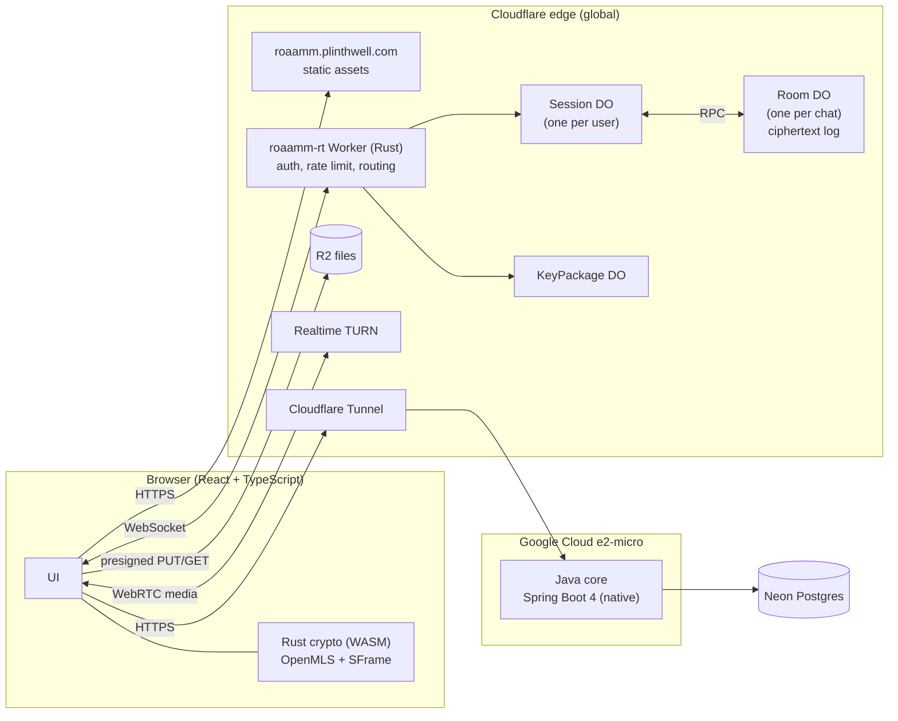

# ROAAMM

[](https://github.com/Vishwath-Narayana/roaamm-travel-app/actions/workflows/ci.yml)
[](https://github.com/Vishwath-Narayana/roaamm-travel-app/actions/workflows/codeql.yml)
[](LICENSE)

**An end-to-end encrypted, real-time web platform for verified solo travellers.** Find other verified travellers on the same dates, chat and call with end-to-end encryption, book licensed local guides by the hour, read and write trip stories, ask an AI assistant who is around this weekend, and stay safe with SOS, live location sharing and check-in timers.

- **Live demo:** `https://roaamm.plinthwell.com` (click **Try demo**, no signup, pick traveller, guide or admin)
- **System page:** `https://roaamm-status.plinthwell.com` (architecture, live latency, load-test report)

> **Status:** Milestone M0 (foundation). The deploy pipeline and monorepo are in place. Product features land milestone by milestone, see [Roadmap](#roadmap). Sections below say "planned" where a feature is not built yet.

All users, trips, chats and reviews in the demo are **simulated data**. The real-time engine and the encryption are real.

## Why this project exists

It is a portfolio project that tries to prove three things with evidence, not adjectives:

1. **System design at scale.** Designed for 50,000 concurrent users and 50,000 concurrent chats, backed by a published k6 load test with 50,000 real WebSocket connections (planned, M11).
2. **Real-time engineering.** Chat over WebSockets on a global edge network, voice and video calls over WebRTC.
3. **Security.** MLS (RFC 9420) end-to-end encryption, SFrame-encrypted calls, passkey login, a written threat model and a hardened web front end.

## Architecture

The system splits by what each part needs most: a fast path for real-time traffic and a steady path for business data. The fast path never waits on the steady path, so chat keeps working even if the Java server is down.



| Path | Carries | Runs on |
|---|---|---|
| Fast path | chat, receipts, typing, presence, call setup, live location | Rust on Cloudflare Workers and Durable Objects |
| Steady path | accounts, passkeys, verification, trips, guides, bookings, payments, stories, admin | Java 25, Spring Boot 4, GraalVM native, Neon Postgres |

Full design, capacity math, latency budget and failure modes: [docs/system-design.md](docs/system-design.md).

## Features

| Feature | Status |
|---|---|
| Passkey sign-up, mock ID verification, Verified badge | planned (M2, M3) |
| Trips and discovery by overlapping dates | planned (M4) |
| End-to-end encrypted 1:1 and group chat, images, voice notes | planned (M5, M6) |
| End-to-end encrypted voice and video calls | planned (M7) |
| SOS, live location, check-in timer | planned (M8) |
| Guides, hourly booking, Razorpay test-mode payments | planned (M9) |
| Stories: trip posts, guide posts, reviews with photos | planned (M9.7) |
| AI assistant over trip and availability data | planned (M9.5) |
| Traveller, guide and admin dashboards | planned (M3 to M9) |
| System page with live latency and load-test report | planned (M10, M11) |

## Honest claims

| Claim | How it is backed |
|---|---|
| Designed for 50,000 concurrent users and chats | Capacity math in the system design doc, plus a published load test (M11) |
| Low latency worldwide | Targets: message delivery p95 under 150 ms in a region and under 300 ms across continents. Live numbers on the System page. |
| Low-latency calls | Peer-to-peer WebRTC with a relay fallback. This project never claims "zero lag". |
| End-to-end encrypted | MLS for chat, SFrame for calls. The threat model states the limit openly: in a browser, the server delivers the JavaScript. See [docs/security.md](docs/security.md). |

## Motion and performance

The web app moves like a product site without paying for it in speed: no
animation or scroll libraries, only CSS (transitions, a generated `linear()`
spring, scroll-driven `animation-timeline`, View Transitions), the Web
Animations API and small React hooks. Everything animates on the compositor
(`transform`, `opacity`, `clip-path`, `filter`), one shared
`requestAnimationFrame` ticker drives pointer effects, and anything off screen
pauses. `prefers-reduced-motion` and a footer "Reduce motion" switch both show
final states instantly.

- Rules, tokens and a checklist for new animations: [docs/motion.md](docs/motion.md)
- `node scripts/motion-bench.mjs`: scrolls, clicks and drags the built site in
  Chrome at 1x and 4x CPU and reports frame timing (99% of frames on time,
  p95 16.8 ms, no long frames).
- Lighthouse mobile in CI: performance >= 0.9, accessibility >= 0.95, no console
  errors.

## Tech stack

| Layer | Choice |
|---|---|
| Web | TypeScript, React 19, Vite, Vitest |
| Edge | Rust (`workers-rs`), Cloudflare Workers, Durable Objects (SQLite), Hibernation API |
| Crypto | Rust, OpenMLS (RFC 9420), SFrame (RFC 9605), compiled to WebAssembly |
| Core | Java 25, Spring Boot 4, virtual threads, GraalVM native image |
| Data | Neon Postgres, Cloudflare R2 |
| Delivery | GitHub Actions, Cloudflare Tunnel (no open inbound ports) |

Everything runs on free tiers. The only planned payment is one month of Cloudflare Workers Paid (about $5) for the load test. Details: [docs/free-services.md](docs/free-services.md).

## Repository layout

```
apps/web/            React app (roaamm.plinthwell.com)
edge/                Rust Worker (roaamm-rt.plinthwell.com)
crates/              Rust crates shared by browser and edge: roaamm-crypto, roaamm-protocol
services/core/       Java core (roaamm-api.plinthwell.com)
status/              System page (roaamm-status.plinthwell.com)
packages/            design tokens, generated API client
loadtest/            k6 scripts and published reports
infra/               server setup and Cloudflare notes
docs/                design docs and architecture decision records
```

## Run it locally

Requirements: Node 22, pnpm 10, Rust stable, JDK 25.

```sh
pnpm install
pnpm dev
```

Checks:

```sh
pnpm lint
pnpm typecheck
pnpm test
cargo test --workspace
cd services/core && gradle check
```

## CI/CD

- **`ci`** runs on every pull request. Jobs run only when their paths change: workflow lint (actionlint), secret scan (gitleaks), web (lint, typecheck, tests, build, bundle-size budget), Rust (fmt, clippy, tests, WebAssembly builds, cargo-deny), core (Gradle check). One required check, `ci-ok`, gates merges to `main`.
- **`codeql`** scans JavaScript/TypeScript, Java and Rust weekly and on pull requests.
- **`deploy`** ships the web app, edge Worker and System page to Cloudflare, builds and pushes the native core image, restarts it on the server with automatic rollback, then smoke-tests every subdomain.
- **`release`** publishes SHA-256 hashes of the built web assets on every `v*` tag, for the planned "verify this build" page.

## Roadmap

| # | Milestone | State |
|---|---|---|
| M0 | Foundation: repo, CI/CD, hello deploys | in progress |
| M1 | Design system and shell | next |
| M2 to M4.5 | Accounts, verification, admin, trips, seed data | planned |
| M5 to M7 | Real-time transport, MLS chat, calls | planned |
| M8 to M9.7 | Safety, guides and booking, stories | planned |
| M9.5 to M10 | AI assistant, observability, System page | planned |
| M11 | 50,000-connection load test and report | planned |
| M12 | Hardening and polish | planned |

Details: [docs/milestones.md](docs/milestones.md) and [docs/addendum-v2.md](docs/addendum-v2.md).

## Documentation

- [Product brief](docs/product-brief.md)
- [System design](docs/system-design.md)
- [Security and end-to-end encryption](docs/security.md)
- [Tech stack](docs/tech-stack.md)
- [Free services and setup](docs/free-services.md)
- [Repo, CI/CD and load-test plan](docs/repo-cicd-loadtest.md)
- [Architecture decision records](docs/adr)
- [Security policy](SECURITY.md)

## Author

Built by [Vishwath Narayana](https://github.com/Vishwath-Narayana). MIT licensed.
