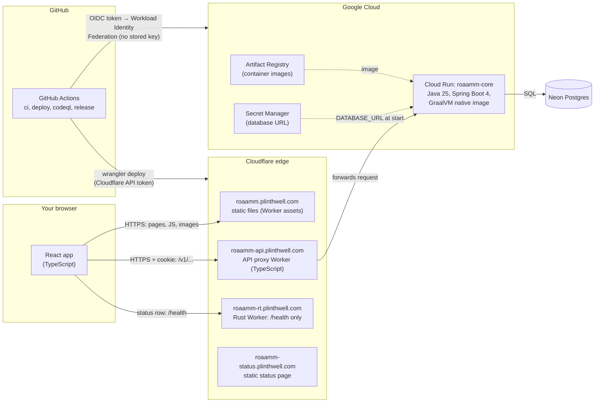

# The big picture

## What ROAAMM is

ROAAMM is a portfolio web app for solo travellers. The finished product is
meant to let verified travellers find each other by trip dates, chat and call
with end-to-end encryption, book local guides, and use safety tools. All
people and data in the demo are **simulated**.

Today (after M3) it has:

- a landing page and a one-click demo with three roles: traveller, guide and
  read-only admin;
- real accounts that sign in with **passkeys** (no passwords);
- **simulated** ID verification, an admin queue and an append-only audit log.

Chat, calls, trips, safety tools and bookings are planned for later
milestones (see [docs/milestones.md](../milestones.md)). They do not exist
yet.

## The system as it exists today

How to read it:

- **Cloudflare edge** is a global network of servers. It serves the web
  app's files and runs small programs called **Workers** close to the user.
- The **API proxy Worker** gives the Java core a nice public name
  (`roaamm-api.plinthwell.com`). It forwards every request to Cloud Run and
  owns the CORS rules.
- **Cloud Run** runs the Java core as a container. It scales to zero when
  nobody uses it, so it costs nothing when idle.
- **Neon** is a hosted Postgres database. It also suspends when idle.
- **GitHub Actions** builds, tests and deploys everything. To deploy to
  Google Cloud it uses **keyless auth**: GitHub hands the job a short-lived
  identity token, and Google swaps it for short-lived credentials. No
  long-lived Google key is stored anywhere.
- The Rust Worker (`roaamm-rt`) only answers `/health` today. It will carry
  chat in M5. The status page is a static page today; its real content is M10.

## One request, start to finish: "Open as Traveller"

This is what happens when you open `/demo` and click **Open as Traveller**.

1. **The page loads.** Cloudflare serves `index.html` and the JavaScript
   bundle. Every path gets the same `index.html` (a "single-page app"); the
   React router in `apps/web/src/router.tsx` reads the path and shows the
   Demo page.
2. **You click the button.** `open("traveller")` in
   `apps/web/src/pages/Demo.tsx` calls `startDemoSession` in
   `apps/web/src/api/session.ts`.
3. **The browser asks permission first.** The request goes to another host
   (`roaamm-api...`) with a custom header, so the browser sends a **CORS
   preflight** (`OPTIONS`) first. The proxy Worker answers it itself and only
   says yes for `https://roaamm.plinthwell.com`.
4. **The real request.** The browser sends
   `POST /v1/demo/session` with `{"role":"traveller"}`, the header
   `X-Roaamm-Csrf: 1`, and `credentials: "include"` (so cookies may be set
   and sent). The page's Content Security Policy allows this host.
5. **The proxy forwards it.** `edge-api-proxy/src/index.ts` rewrites the
   address to the Cloud Run URL, sets `X-Roaamm-Client-Ip` from Cloudflare's
   view of your IP, drops Cloudflare's own headers, and waits at most 20 s.
6. **Cloud Run wakes up if needed.** If no instance is running, Cloud Run
   starts one. The native image starts in under a second (about 0.7 s was
   measured in CI-style tests, migrations included). On start, **Flyway**
   applies any new database migrations.
7. **The core checks the request.** `CsrfFilter` checks the exact `Origin`
   and the CSRF header, and refuses the request with 403 if either is wrong.
8. **The core makes a session.** `AuthController.demoSession` checks the
   role and the rate limit (`DemoRateLimiter`: 10 demo sessions per IP per
   10 minutes). `SessionTokens` makes 32 random bytes as the
   token; the core stores only its **SHA-256 hash** in the `sessions` table in
   Neon (Neon wakes up if it was suspended), and answers with
   `Set-Cookie: __Host-roaamm_session=...; HttpOnly; Secure; SameSite=Lax`
   and a small JSON body describing the demo user.
9. **The proxy passes the cookie back** and adds
   `Cache-Control: no-store, private` so nothing caches it.
10. **The browser stores the cookie** for the API host. Page scripts cannot
    read it (HttpOnly). The app remembers only the role name in
    `localStorage` so it can tell "expired" from "never signed in".
11. **The app navigates** to `/app/traveller` with the History API (no full
    page load), using a View Transition cross-fade where supported.
12. **The dashboard loads.** Its code is a lazy chunk, downloaded now. It
    calls `GET /v1/me`; the browser sends the cookie; the core hashes it,
    finds the session and returns who you are. The traveller dashboard then
    shows the verification card, which calls `GET /v1/verification/me`.

If anything fails (API asleep too long, rate limit, no session), the page
shows an honest message instead of a blank screen.

## Where things live

| Folder | What it is | Public address |
|---|---|---|
| `apps/web/` | React app | `roaamm.plinthwell.com` |
| `edge-api-proxy/` | TypeScript Worker in front of the core | `roaamm-api.plinthwell.com` |
| `services/core/` | Java core (Spring Boot, native image) | behind the proxy |
| `edge/` | Rust Worker (health only today) | `roaamm-rt.plinthwell.com` |
| `status/` | Static status page | `roaamm-status.plinthwell.com` |
| `crates/` | Rust libraries for the future crypto and protocol | none |
| `packages/` | Shared design tokens; an API client package that is still a placeholder | none |
| `.github/workflows/` | CI, deploy, CodeQL and release pipelines | none |
| `docs/` | Design docs, ADRs, runbooks, and this folder | none |
