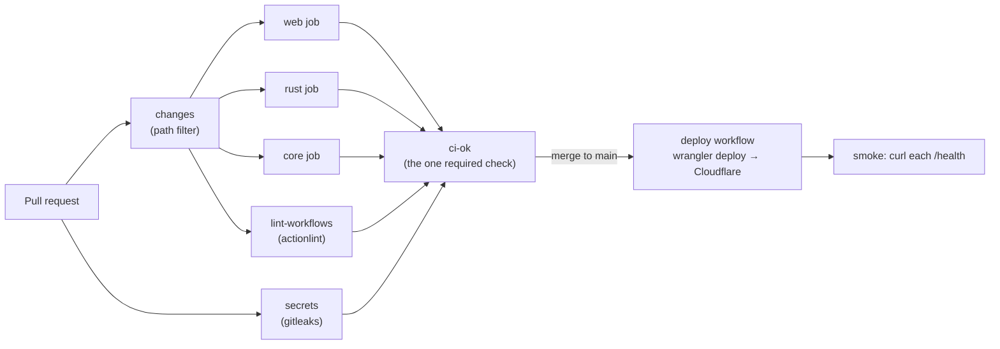

# M0: Foundation

PR [#1](https://github.com/Vishwath-Narayana/roaamm-travel-app/pull/1) and the
fix [#7](https://github.com/Vishwath-Narayana/roaamm-travel-app/pull/7),
merged 2026-11-21.

## What we built and why

One repository (a **monorepo**) with a place for every part: web app, Rust
edge Worker, Rust libraries, Java core, status page and docs. CI checks every
pull request and one job, `ci-ok`, decides if it may merge. A deploy
pipeline ships "hello" versions to Cloudflare. The point was to have the
pipeline working before any feature, so every later change is tested and
shipped the same way.

## How it works

1. A pull request starts `ci.yml`. The `changes` job looks at which folders
   changed, so only the needed jobs run.
2. Each job runs its checks: lint, typecheck, tests and build for web; fmt,
   clippy, tests and WebAssembly builds for Rust; Gradle check for Java.
3. `ci-ok` passes only if every other job passed or was skipped. GitHub
   branch protection requires only this one check.
4. After merge, `deploy.yml` deploys the web app, the Rust Worker and the
   status page to Cloudflare, then curls each `/health`. Each part is off
   until a repository variable (`DEPLOY_ENABLED`) is `true`.
5. `codeql.yml` scans for security bugs. `release.yml` publishes SHA-256
   hashes of the built web files on each `v*` tag.

## Key files to open

- `.github/workflows/ci.yml`: the `changes` filter and the `ci-ok` job at the
  bottom
- `.github/workflows/deploy.yml`: the deploy and smoke jobs
- `.github/workflows/codeql.yml`, `.github/workflows/release.yml`
- `.github/dependabot.yml`, `.github/pull_request_template.md`
- `pnpm-workspace.yaml`, `package.json`, `Cargo.toml`: how the monorepo is
  tied together
- `edge/src/lib.rs`: the Rust Worker that answers `/health`
- `crates/roaamm-crypto/src/lib.rs`: AES-256-GCM placeholder so the crate and
  its WebAssembly build are wired into CI (MLS comes in M6)
- `status/public/index.html`, `apps/web/wrangler.toml`
- `docs/milestones.md`, `docs/system-design.md`

## New terms

Monorepo, CI/CD, GitHub Actions, workflow, job, path filter, required check,
`ci-ok`, actionlint, gitleaks, CodeQL, Dependabot, wrangler, Worker, Rust,
crate, WebAssembly, Cargo, clippy, cargo-deny, Gradle wrapper, smoke test,
repository variable. See the [glossary](glossary.md).

## Mistakes and fixes

- **The very first CI run failed.** Run
  [44909467396](https://github.com/Vishwath-Narayana/roaamm-travel-app/actions/runs/44909467396):
  the `core` job (Gradle check) and `lint-workflows` (actionlint) failed. A
  follow-up commit in the same PR, "fix: random keys in crypto tests, Gradle
  9.1 for Java 25, shellcheck warning", fixed it. The lesson: a newer Java
  version needs a Gradle version that supports it, and actionlint also runs
  shellcheck on the `run:` scripts inside workflows.
- **The first deploy failed at "Deploy web".** Run
  [44912596731](https://github.com/Vishwath-Narayana/roaamm-travel-app/actions/runs/44912596731)
  used `cloudflare/wrangler-action@v3`. PR #7 replaced it with
  `pnpm dlx wrangler@4 deploy` and skipped the API health check until the
  core existed. The exact error inside the wrangler action is **not
  verified**; the log does not show it clearly.
- **Done-when not fully met at M0.** The milestone says all four subdomains
  answer from CI deploys. `roaamm-api` only started answering in M2-prep-2
  (PR #15). Sentry is listed in the milestone but no Sentry code exists in
  the repo today.
- **Early hosting plan replaced.** `infra/server/` holds the first plan: a VM
  with Docker and Cloudflare Tunnel. ADR 0003 replaced it with Cloud Run.

## Try it yourself

1. Run `curl https://roaamm-rt.plinthwell.com/health` and
   `curl https://roaamm.plinthwell.com/health.json`. Both answer
   `{"status":"ok"}`-style JSON.
2. On GitHub, open the Actions tab, pick any `ci` run and find the `ci-ok`
   job. Read its log line `results: ...`.
3. Run `cargo test --workspace` in the repo root (needs Rust) to run the
   crypto, protocol and edge tests.

## Test yourself

1. Why does the project have exactly one required check?
2. What does the `changes` job do, and why does it save time?
3. What would happen to `ci-ok` if the `web` job was cancelled?
4. How is a deploy switched off without deleting the workflow?
5. What does `release.yml` publish, and what is it for?

### Answers

1. So branch protection never needs updating when jobs are added or
   renamed; `ci-ok` sums them all up.
2. It checks which folders changed and sets outputs, so jobs for untouched
   parts are skipped.
3. It fails: its script treats both `failure` and `cancelled` as failed.
4. Each deploy job has `if: vars.DEPLOY_ENABLED == 'true'` (or
   `CORE_DEPLOY_ENABLED`); leave the variable unset.
5. SHA-256 hashes of the built web files, for a planned "verify this build"
   page.
