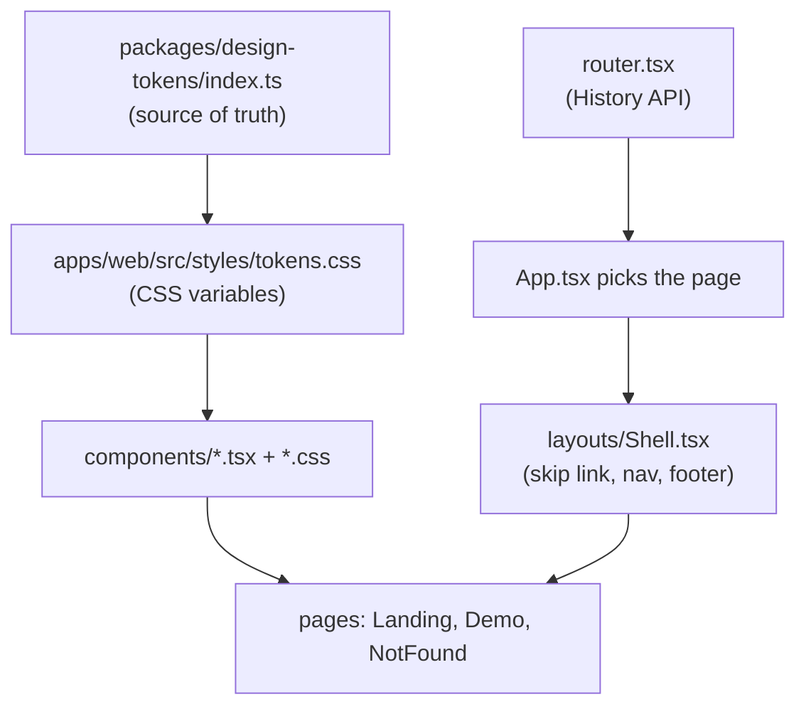

# M1: Design system, app shell and landing page

PR [#9](https://github.com/Vishwath-Narayana/roaamm-travel-app/pull/9),
merged 2026-11-21.

## What we built and why

The look and the skeleton of the web app: design tokens (colours, spacing,
type), base components (Button, Badge, Card, Input, Toast, TopNav), an app
shell with a skip link, nav and footer, a tiny router, light and dark themes,
and the first landing, demo and 404 pages. CI started running Lighthouse.
Every later page is built from these pieces, so they had to come first.

## How it works

1. Tokens are written once in TypeScript and mirrored as CSS variables. A
   test fails if the two drift apart.
2. `router.tsx` listens to the URL. `navigate()` calls `history.pushState`
   and tells React to re-render. There is no router library.
3. `App.tsx` maps a path to a page and wraps it in `Shell`.
4. After a route change, focus moves to the new page's `h1`, so screen
   reader users hear where they are.
5. `theme.ts` reads the saved theme from `localStorage` or follows the system
   setting.

## Key files to open

- `packages/design-tokens/index.ts` and `apps/web/src/styles/tokens.css`
- `apps/web/src/styles/tokens.test.ts`: keeps the two in sync
- `apps/web/src/router.tsx`, `apps/web/src/App.tsx`
- `apps/web/src/layouts/Shell.tsx`, `apps/web/src/layouts/Footer.tsx`
- `apps/web/src/components/Button.tsx`, `apps/web/src/components/TopNav.tsx`
- `apps/web/src/theme.ts`
- `apps/web/lighthouserc.json`: the Lighthouse thresholds

## New terms

Design tokens, component, React, TypeScript, Vite, Vitest, router, History
API, SPA, skip link, focus management, Lighthouse, accessibility (a11y),
dark mode. See the [glossary](glossary.md).

## Mistakes and fixes

- **Focus jumped on first load.** Moving focus to the `h1` after a route
  change also fired on the very first load in React's development
  StrictMode (which runs effects twice). The fix commit was "do not move
  focus to the h1 on first load under StrictMode".
- **Docs and code differ on Tailwind.** `docs/milestones.md` mentions a
  "Tailwind theme", but the repo uses plain CSS with variables. No Tailwind
  dependency exists. Why the plan changed is **not verified**.

## Try it yourself

1. Run `pnpm install` then `pnpm dev`, open the printed local URL, and switch
   the theme in the nav.
2. Press Tab once on a fresh page: the "Skip to content" link appears.
3. Run `pnpm --filter @roaamm/web test -- tokens` and read what the token
   test checks.

## Test yourself

1. Where is the single source of truth for colours?
2. How does the app change pages without a full page load?
3. Why move focus to the `h1` after navigation?
4. What two Lighthouse categories does CI enforce, and at what scores?

### Answers

1. `packages/design-tokens/index.ts`; `tokens.css` mirrors it and a test
   checks they match.
2. `navigate()` in `router.tsx` calls `history.pushState` and fires an event
   that makes React re-render the matching page.
3. So keyboard and screen reader users land on the new content and hear its
   title, like after a normal page load.
4. Performance at least 0.9 and accessibility at least 0.95
   (`apps/web/lighthouserc.json`). Later, console errors were added too.
