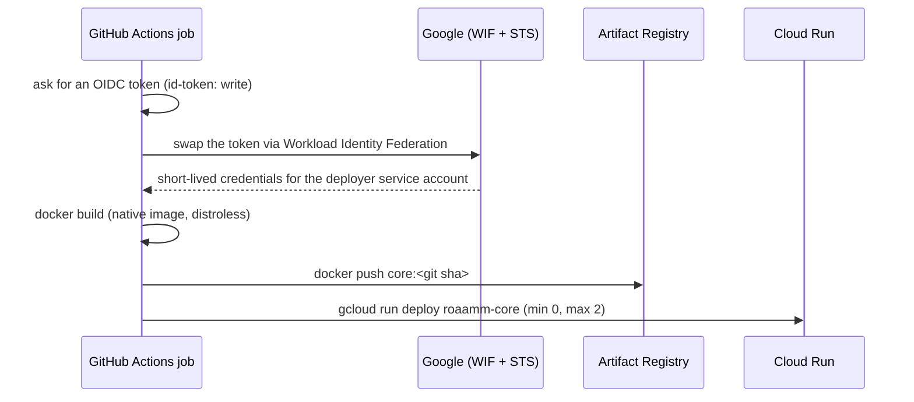

# M2-prep: Java core on Cloud Run, keyless deploys and the API proxy

PRs [#14](https://github.com/Vishwath-Narayana/roaamm-travel-app/pull/14)
(M2-prep) and [#15](https://github.com/Vishwath-Narayana/roaamm-travel-app/pull/15)
(M2-prep-2), merged 2026-11-22. Decision: [ADR 0003](../adr/0003-core-hosting-cloud-run.md).

## What we built and why

A minimal Java core that only answers `GET /health`, compiled to a GraalVM
native image and packed into a tiny container. A deploy job that ships it to
Google Cloud Run with no stored Google key. A TypeScript Cloudflare Worker that
gives it the public name `roaamm-api.plinthwell.com`. Accounts need a server,
so the server, its hosting and its deploy path had to work first.

## How it works

And for each request after deploy:

1. The browser calls `https://roaamm-api.plinthwell.com/...`.
2. The proxy Worker (`edge-api-proxy/src/index.ts`) answers CORS preflights
   itself and forwards everything else to the Cloud Run URL, rewriting the
   host so Cloud Run accepts it.
3. If Cloud Run does not answer within 20 s, the proxy returns
   `502 {"error":"bad_gateway",...}` and never shows the real error.

**The Docker build has two stages:** stage 1 compiles the native binary
inside a GraalVM image; stage 2 copies only that binary into a distroless
image and runs it as a non-root user.

## Key files to open

- `services/core/Dockerfile`: read the comments
- `services/core/build.gradle.kts`, `services/core/src/main/resources/application.yml`
- `services/core/src/main/java/com/plinthwell/roaamm/common/HealthController.java`
- `.github/workflows/deploy.yml`: the `core` and `api-proxy` jobs, and
  `permissions: id-token: write`
- `edge-api-proxy/src/index.ts`, `edge-api-proxy/test/index.test.ts`,
  `edge-api-proxy/wrangler.toml`
- `docs/adr/0003-core-hosting-cloud-run.md`

## New terms

Spring Boot, GraalVM native image, AOT, Gradle wrapper, Docker multi-stage
build, distroless image, Cloud Run, scale to zero, cold start, min/max
instances, Artifact Registry, OIDC token, Workload Identity Federation,
service account, keyless deploy, Worker custom domain, CORS preflight, 502.
See the [glossary](glossary.md).

## Mistakes and fixes

- **The smoke test failed because the API name did not exist yet.** Deploy
  run [45050050239](https://github.com/Vishwath-Narayana/roaamm-travel-app/actions/runs/45050050239)
  failed in `smoke` with "Could not resolve host: roaamm-api.plinthwell.com".
  The core was on Cloud Run, but nothing served that hostname. PR #15 added
  the proxy Worker as a custom domain, which creates the DNS record and
  certificate itself.
- **A plain DNS record to Cloud Run would not work.** Cloud Run checks the
  `Host` header, so a simple CNAME fails. That is why a Worker rewrites the
  request.
- **Rejected: Cloud Run domain mappings.** They were still Preview, and do
  not work well behind Cloudflare's proxy (ADR 0003).
- **Why TypeScript, not Rust, for this Worker:** it is about 100 lines of
  header handling; wrangler bundles TypeScript with no build step, and it
  tests with plain Vitest.
- **Cold start was not measured at this point.** ADR 0003 marked it
  UNMEASURED; the first measurement came later (see the M2a note).

## Try it yourself

1. Run `curl -si https://roaamm-api.plinthwell.com/health` and read the
   headers the proxy adds.
2. Run `curl -si -X OPTIONS -H "Origin: https://example.com" -H "Access-Control-Request-Method: POST" https://roaamm-api.plinthwell.com/v1/demo/session`.
   The proxy refuses the preflight for another origin.
3. Run `pnpm --filter @roaamm/api-proxy test` and read the test names.

## Test yourself

1. What does "keyless deploy" mean here, and what is stored in GitHub?
2. Why does the core use a native image?
3. What happens if a visitor arrives while no Cloud Run instance is running?
4. Why does the proxy drop `Access-Control-*` headers from the core?
5. What stops a bug or traffic spike from running up a large bill?

### Answers

1. No Google key exists. The job gets a short-lived OIDC token from GitHub
   and swaps it for short-lived Google credentials. GitHub stores only
   non-secret repository variables (provider name, service account email,
   region, project, image repo).
2. It starts in well under a second and uses less memory, which matters when
   the service scales from zero.
3. Cloud Run starts one (a cold start). The first request waits a bit longer.
4. The proxy owns CORS in one place, so the rules cannot disagree.
5. `--max-instances 2` and a budget alert on the Google Cloud project.
