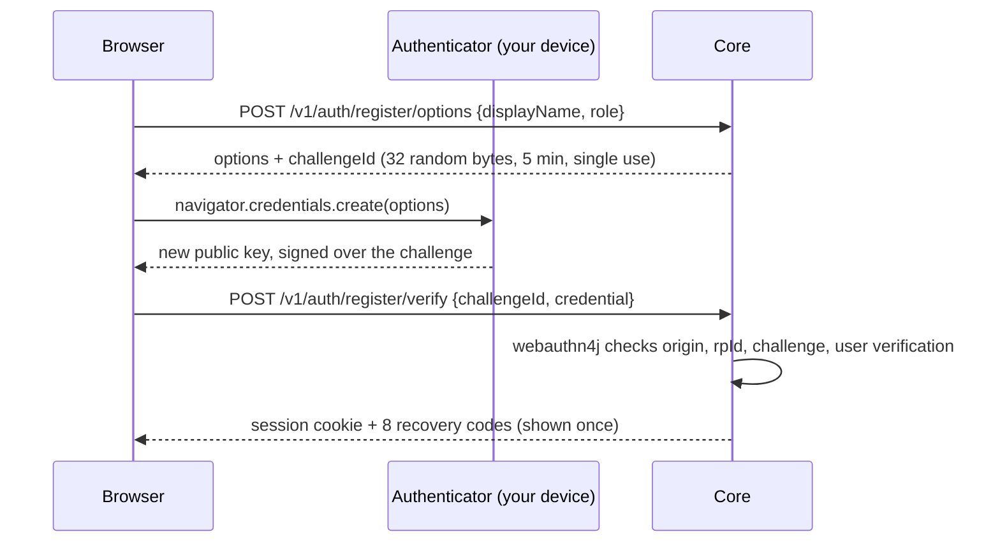

# M2b: Passkey accounts

PRs [#20](https://github.com/Vishwath-Narayana/roaamm-travel-app/pull/20)
(core) and [#21](https://github.com/Vishwath-Narayana/roaamm-travel-app/pull/21)
(web), merged 2026-11-23. Decision: [ADR 0005](../adr/0005-passkeys.md).

## What we built and why

Real accounts with **passkeys only**: no password, email or phone. You pick
a display name and a role (traveller or guide), your device makes a passkey,
and you get 8 one-time recovery codes. `/login` signs in with no username.
`/account` lists passkeys, adds or removes one, and makes new codes. Demo
login stays the main button. Passkeys avoid storing secrets or personal data.

## How it works

Sign-in is the same shape with `/v1/auth/login/options` and `/verify`; the
device picks the passkey (a **discoverable credential**), so there is no
username step. Only the **public key** is stored. Recovery codes are stored as
SHA-256 hashes. Deleting a passkey or making new codes needs a **fresh
passkey check** in the last 5 minutes.

## Key files to open

- `docs/adr/0005-passkeys.md`: the full rules and the API table
- `services/core/src/main/resources/db/migration/V3__passkeys.sql`,
  `V4__no_passkeys_on_demo_users.sql`
- `services/core/src/main/java/com/plinthwell/roaamm/passkey/PasskeyVerifier.java`,
  `PasskeyAuthController.java`, `AccountService.java`, `RecoveryCodes.java`
- `.../passkey/WebAuthnRuntimeHints.java`: why the native image can read
  passkey data
- `services/core/src/test/java/com/plinthwell/roaamm/support/SoftAuthenticator.java`:
  a fake authenticator for tests
- `scripts/ci/passkey-smoke.mjs`: a real round trip against the native image
- `apps/web/src/pages/auth/Signup.tsx`, `Login.tsx`, `Account.tsx`,
  `messages.ts`

## New terms

Passkey, WebAuthn, authenticator, discoverable credential, rpId, origin
check, challenge, user verification, attestation, sign count, recovery code,
fresh check (reauth), user enumeration, reflection hints. See the
[glossary](glossary.md).

## Mistakes and fixes

- **The demo-account passkey risk.** Demo users are shared by every visitor.
  If a visitor could add a passkey or recovery codes to a shared demo
  account, that account would no longer be a clean sandbox for everyone
  else. The API already refused it (`realUser()` check, 403 `not_for_demo`),
  but a later bug could undo that. Fix (commit `3a6eb63`): migration V4 adds
  **database triggers** that refuse any passkey or recovery code owned by a
  demo user, plus `DemoBoundaryTest`, which checks all 7 credential
  endpoints for all 3 demo roles. Two layers, so one mistake is not enough.
- **No native-image metadata in the library.** webauthn4j does not ship
  hints for GraalVM. Fix: `WebAuthnRuntimeHints` registers its types for
  reflection, and CI proves it with a real round trip on the native image.
- **A cancelled run on the web branch.** A newer push to #21 started a new
  CI run, so the older run
  ([45141499197](https://github.com/Vishwath-Narayana/roaamm-travel-app/actions/runs/45141499197))
  was cancelled during `pnpm typecheck` and `ci-ok` showed failed. The newer
  run is the one that counts.
- **No browser test with a virtual authenticator.** The rpId must be
  `roaamm.plinthwell.com` over HTTPS, so it is not cheap in CI. The web
  tests mock `navigator.credentials` instead, and the core smoke covers the
  real cryptography. This is a known gap, not a hidden one.

## Try it yourself

1. On the live site open `/login` and click "Sign in with passkey", then
   cancel the prompt. Read the message: cancelled and timed out are told
   apart by elapsed time.
2. Run `cd services/core && ./gradlew test --tests '*DemoBoundaryTest*'`
   (needs Docker) and read the test names.
3. Open `scripts/ci/passkey-smoke.mjs` and follow one register and login
   round trip.

## Test yourself

1. What does the server store for a passkey, and why is that safe?
2. Why is sign-in possible with no username?
3. What is a challenge for, and why is it single use?
4. Why do demo accounts refuse passkeys in two places?
5. When is a fresh passkey check needed?

### Answers

1. The public key and some flags. A public key cannot be used to sign in,
   so a database leak gives nothing usable.
2. Passkeys are discoverable: the device knows which passkeys it holds for
   `roaamm.plinthwell.com` and offers them.
3. It proves the passkey signed something just now. Single use stops a
   captured response from being replayed.
4. Defence in depth: the API refuses it, and the database triggers refuse it
   even if the API had a bug.
5. Before deleting a passkey or making new recovery codes; the check must be
   within the last 5 minutes.
