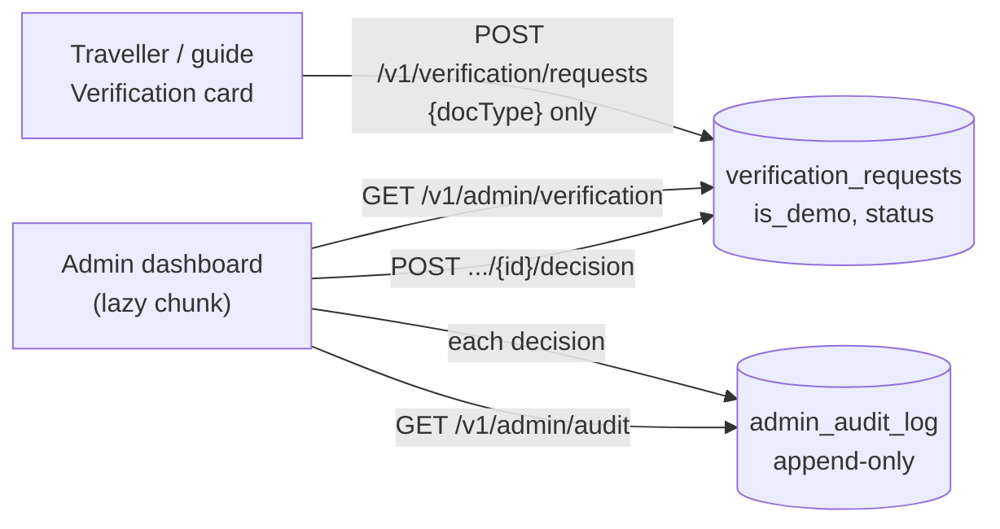

# M3: Simulated ID verification, admin queue and audit log

PRs [#22](https://github.com/Vishwath-Narayana/roaamm-travel-app/pull/22)
(core) and [#23](https://github.com/Vishwath-Narayana/roaamm-travel-app/pull/23)
(web), merged 2026-11-23, plus the polish PR
[#24](https://github.com/Vishwath-Narayana/roaamm-travel-app/pull/24).
Decisions: [ADR 0006](../adr/0006-simulated-verification.md) and
[ADR 0007](../adr/0007-landing-only-hero-preload.md).

## What we built and why

Travellers and guides can ask to be "verified". **No real ID is collected**:
a request stores only a document type and a made-up `SAMPLE-` reference. An
admin approves or rejects it in a queue, and every decision is written to an
**append-only audit log**. The demo admin can look at everything but change
nothing, and demo rows never mix with real ones. This gives the "verified"
badge without ever holding a real identity document.

## How it works

1. The member picks a document type, clicks "Use sample ID" and confirms.
   The core reads only `docType`; any other field is ignored.
2. Status comes from the member's latest request: none, pending, verified or
   rejected. A real user can have only one pending request (a unique index).
3. An admin lists requests by status and approves, or rejects with a reason
   (1 to 200 characters). Repeating the same decision changes nothing; the
   opposite decision gets `409 already_decided`.
4. **Scope:** every row has `is_demo`. The demo admin sees only demo rows; a
   real admin sees only real rows; a row from the other scope is `404`.
5. **Audit log:** triggers refuse `UPDATE`, `DELETE` and `TRUNCATE`. There is
   no foreign key to the admin, so deleting an account never rewrites
   history.
6. **First real admin:** signup never makes an admin. The owner promotes
   their own account with one SQL update from
   [the runbook](../runbooks/first-admin.md).

## Key files to open

- `services/core/src/main/resources/db/migration/V5__verification_and_audit.sql`:
  tables, triggers and the four simulated sample people
- `services/core/src/main/java/com/plinthwell/roaamm/verification/VerificationService.java`,
  `VerificationRepository.java`, `VerificationController.java`
- `services/core/src/test/java/com/plinthwell/roaamm/verification/VerificationTest.java`
- `scripts/ci/verification-smoke.mjs`
- `apps/web/src/pages/app/VerificationCard.tsx`, `AdminPanel.tsx`
- `docs/runbooks/first-admin.md`
- `scripts/check-console.mjs`, `apps/web/src/heroPreload.test.ts` (from #24)

## New terms

Append-only table, trigger, unique index, scope (`is_demo`), idempotent,
409 Conflict, seed data, runbook, WAI-ARIA tabs, bundle budget, CSP hash,
preload, CodeQL. See the [glossary](glossary.md).

## Mistakes and fixes

- **Migration number.** The task asked for V4, but V4 was already used by
  the demo-passkey triggers from M2b. It became **V5**. Flyway needs unique,
  ordered numbers, so always check the folder first.
- **The first admin could not be created.** M2b added a database rule that
  real users can never be admin. V5 relaxed it so the runbook's single
  `UPDATE` works; signup still refuses `admin` in the API (tested again).
- **Admins could vanish.** The 90-day inactive purge would have deleted the
  owner's admin account. Admins are now exempt.
- **A cancelled run, again.** #22 and #23 were merged 12 seconds apart, and
  the `main` run for #22
  ([45153490704](https://github.com/Vishwath-Narayana/roaamm-travel-app/actions/runs/45153490704))
  was cancelled and showed `ci-ok` failed. Same cause as in M2a.
- **Polish after merge (PR #24):**
  - the audit log's "Request" column showed `00000000` on every row, the
    first 8 characters of the seeded ids. It now shows the person's name
    and the last 8 characters;
  - the read-only banner said "simulated sample people only", but the queue
    also shows demo visitors' requests. The copy was corrected;
  - every page except `/` logged "preloaded but not used" for the hero
    photo. ADR 0007 moved the preload into a tiny script that runs on `/`
    only, and a new CI console check opens 8 routes in headless Chrome;
  - CodeQL flagged the first version of the preload test, which used a
    regular expression to find `<script>` (it missed upper-case tags). The
    test now parses the HTML with `DOMParser`.
- **Stacked PRs and merge conflicts:** the web PRs (#18, #21, #23) were
  each based on `main`, not on the core branch, and merged in the stated
  order. No conflict-resolution commits or force-pushes appear in their
  history, so whether conflicts happened locally is **not verified**.

## Try it yourself

1. On the live site open `/demo`, click **Open as Admin**, and look at the
   queue and the audit log. Try Approve: it is disabled, with the reason.
2. Open **Open as Traveller**, start verification, pick a type, click "Use
   sample ID" and confirm. Demo visitors' requests are deleted after 24 hours.
3. After `pnpm build`, run `node scripts/check-console.mjs` (needs Chrome)
   and see each route reported clean.

## Test yourself

1. What does a verification request store, and what does it never store?
2. How does the database stop anyone editing the audit log?
3. What does the demo admin see, and what can it change?
4. Why was the new migration V5 and not V4?
5. Why did the hero preload cause a warning on every page but `/`?

### Answers

1. A document type and a server-made `SAMPLE-` reference. Never a document,
   number, photo or real name.
2. Triggers raise an error on `UPDATE`, `DELETE` and `TRUNCATE`.
3. Only demo rows (`is_demo = true`), including the sample people and demo
   visitors' requests. It can change nothing; writes return
   `403 read_only_demo`.
4. V4 already existed (the demo-passkey triggers from M2b); Flyway versions
   must be unique and in order.
5. All routes share one `index.html`. The preload fetched the hero photo
   everywhere, but only `/` shows it, so Chrome warned that it went unused.
