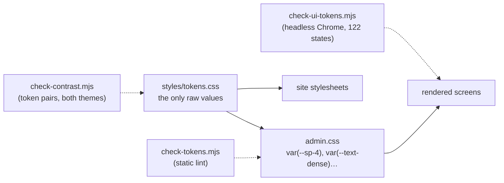

# M4b.1: A real design system for the admin console

Branch `feat/m4b1-admin-polish`. UI only: no API, database or migration change.
Decision: [ADR 0009](../adr/0009-one-tokens-file.md). The rules themselves are
in [docs/design-system.md](../design-system.md).

## What we built and why

The M4b admin console worked but looked improvised: spacing by eye, a bluish
dark theme, solid status blocks and desktop tables squeezed onto phones. M4b.1
puts every colour, size and space into one tokens file, rebuilds each screen
on it, and adds three checks so nothing can drift back. Phones get their own
layout (list rows and bottom sheets), not a shrunk desktop.

## How it works

1. **Tokens.** `tokens.css` defines a 4 px spacing scale (`--sp-1` = 4 px up to
   `--sp-16` = 64 px), seven type roles (11/16 label up to 28/36 KPI), three
   weights, five radii, and the colours for both themes. Dark mode is pure
   black with pure greys.
2. **Status colours are tints.** A pill's fill is its hue at 14% alpha, so it
   reads the same on a card, a hovered row or a selected row.
3. **One table, one drawer.** `DataTable` renders every list. On a phone it
   renders two-line rows instead. `Drawer` is a side panel on desktop and a
   bottom sheet on a phone.
4. **Unavailable, not hidden.** In the demo, action buttons keep their labels
   and use `aria-disabled` plus a tooltip (hover, keyboard focus and tap), and
   one banner says the demo is read-only.
5. **Checks.** The lint reads the CSS text; the contrast check computes every
   colour pair; the UI check measures the rendered pages.

## Key files to open

- `apps/web/src/styles/tokens.css`: every value, light and dark
- `docs/design-system.md`: the rules, which element uses which type role, and
  the computed contrast table
- `apps/web/src/admin/ui.tsx`: `DataTable`, `Drawer`, `unavailable()`,
  `cleanTitle()`, `relTime()`
- `apps/web/src/admin/admin.css`: the console, written only with tokens
- `scripts/check-tokens.mjs`, `scripts/check-contrast.mjs`,
  `scripts/check-ui-tokens.mjs`, `scripts/ui-harness.mjs`
- `apps/web/src/admin/screens/Overview.tsx`: the Recent activity card and the
  layout-shift guard

## New terms

Design token scale, ratchet, layout shift (CLS), tabular numbers, tap target,
bottom sheet, `aria-disabled`, translucent tint. All are in the
[glossary](glossary.md).

## Mistakes and fixes

All of these were found while building M4b.1, before its commits. The fixes
are part of commits `770f879` (the console) and `16c8140` (the lint).

- **A reset that won every fight.** `.adm :is(p, ul…) { margin: 0 }` has a
  higher specificity than a single class, so the 16 px space above each
  sidebar group silently became 0. Fix: `:where()`, which has zero specificity.
- **A chevron 0 px wide.** The table's chevron cell had `width: 16px` with
  border-box sizing and 32 px of padding, so its content box was 0, and the
  site's global `svg { max-width: 100% }` shrank the icon to nothing. Found in
  a screenshot, not by a check. Fix: content-box cells and `max-width: none`
  for console icons, and the UI check now fails on any icon that renders at
  0 px.
- **The lint let a marketing radius through.** `--radius-card` (24 px) matched
  the rule "any `--radius-*` token". Fix: only the five UI radii are allowed
  (`16c8140`).
- **Layout shift nobody had measured.** Lighthouse only checks `/`. The new UI
  check measured the Overview at up to 0.074 CLS: KPI placeholders 4 px
  shorter than real cards, and three lists arriving at different times. Fix:
  every KPI row has a fixed height, and the lists render once everything has
  answered. The worst state is now 0.0003.
- **Group labels squashed into a 1 px line** on the tablet rail counted as
  clipped text. Fix: hide the label for sighted users only (it still names
  its list) and draw a separate rule.

## Try it yourself

1. `node scripts/check-contrast.mjs` and read the worst surface for each pair.
2. Add `padding: 10px;` to any rule in `apps/web/src/admin/admin.css` and run
   `node scripts/check-tokens.mjs`; it fails with the line number. Undo it.
3. After `pnpm build`, run
   `node scripts/check-ui-tokens.mjs --only overview --verbose`, then again with
   `UI_CHECK_INJECT_CSS='.adm *::before{content:none!important}'` to see every
   phone tap target that relies on its extended hit area.

## Test yourself

1. Why are status tints translucent instead of solid colours?
2. A pill must reach 4.5:1. Why does the contrast check test it on five
   different surfaces?
3. Why does the demo show disabled checkboxes instead of hiding the column?
4. What does `:where()` change compared with `:is()`?
5. Why does the Overview render its lists all at once?

## Answers

1. A translucent tint takes on the surface under it, so the same pill looks
   right on a card, a hovered row and a selected row in both themes, and
   never becomes an opaque block.
2. The tint is composited over whatever it sits on: the page, a card, a
   raised panel, a hovered row or a selected row. The check takes the worst.
3. An empty checkbox column pushed the first text column to the right on the
   tables with bulk actions only, so tables did not line up with each other.
   Showing the column, disabled, keeps one alignment rule, and the tooltip
   explains why.
4. `:where()` has zero specificity, so any component class written later wins
   over the reset; `:is()` takes the specificity of its most specific argument.
5. Each list that arrived late pushed the cards below it down (a layout
   shift). Rendering them together means nothing exists below the KPIs to be
   pushed.
