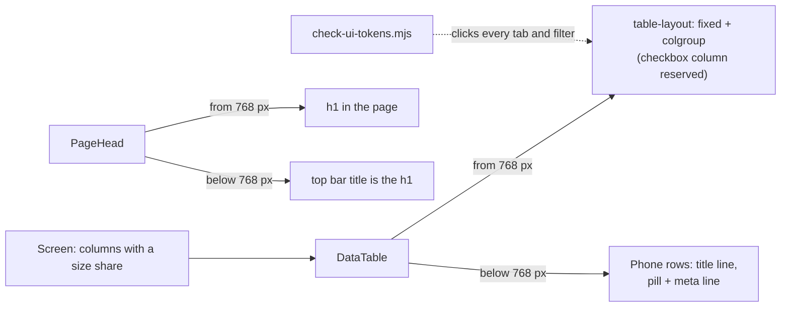

# M4b.2: Second admin polish pass

Branch `feat/m4b2-admin-polish`. UI only: no API, database or migration change.
No new architecture decision (ADR): it applies [ADR 0009](../adr/0009-one-tokens-file.md).
The rules are in [docs/design-system.md](../design-system.md).

## What we built and why

A review of the M4b.1 console on desktop and phone found what still looked
unfinished: tables whose columns jumped between tabs, a page title shown twice
on phones, repeated labels ("Sample" on every row, a status pill inside a
status column), heavy grey buttons on every card, and filters cut off at the
screen edge. M4b.2 fixes them with existing tokens and adds checks so they stay fixed.

## How it works

1. **One column template per screen.** Each column says its share of the
   width (`size: 30`); the checkbox, ⋯ and chevron columns are fixed. The
   table uses `table-layout: fixed`, so the data can never resize a column.
   Verification reserves its checkbox column on every tab.
2. **One h1.** `PageHead` renders the h1 from 768 px up. Below that, the top
   bar's title is the h1 and the page header keeps only its lead (for screen
   readers below 640 px) and its actions. The router focuses `main h1`, or
   any h1 when there is none in `main`.
3. **Say it once.** The banner is the only place that says the data is
   simulated: no Sample chip, and the scope chip reads "Demo accounts".
   Board cards drop the status pill (the column says it).
4. **Calmer controls.** Row and card menus are a 32 px ⋯ icon button. Board
   column headers are neutral with a coloured dot. Users shows a check icon
   instead of a Verified chip.
5. **Phone.** Filters fill the row with equal segments, one group per row,
   scroll only if they must, fade only the side with more, and keep the
   selected option in view. The KPI cards use short labels so their numbers
   line up. Titles get the whole first line.
6. **Drawer summaries.** Every detail drawer opens with an avatar or icon, the
   name, the status and three key facts; details and the timeline follow.

## Key files to open

- `apps/web/src/admin/ui.tsx`: `DataTable` (the `<colgroup>`), `Scroller`
  (edge fade, selected option in view), `Drawer` (summary), `PageHead`,
  `VerifiedMark`
- `apps/web/src/admin/admin.css`: the table template, phone rows, segments
- `apps/web/src/admin/screens/*.tsx`: each screen's column shares
- `apps/web/src/admin/MoveMenu.tsx`: the ⋯ button
- `scripts/check-ui-tokens.mjs`: the new assertions;
  `scripts/ui-harness.mjs`: the 1024 px viewport and `TABLE_SCREENS`

## New terms

Column template (`table-layout: fixed`, `<colgroup>`), edge fade
(`mask-image`), visually hidden. All are in the [glossary](glossary.md).

## Mistakes and fixes

All of these were found while building M4b.2, before its first commit.

- **The new checks fail on main.** Run against a build of `main` (commit
  `42e3acc`) with `UI_DIST=<main dist>`, the new assertions fail 95 states:
  59 table-layout problems (headers move between tabs and filters on
  Verification, Guide list and Users; Audit's Subject clipped at 1024 and
  1440 px), 20 KPI baselines, 46 avatar edges and 48 Sample chips. On this
  branch they all pass. The one-h1 check passes on both: main already had one h1.
- **A right-aligned header over left-aligned cells.** `.adm-table td` (two
  selectors' worth of specificity) beat `.adm-col--end` (one), so the Audit
  "When" cells were left-aligned under a right-aligned header. This was
  already on `main`; found in a 1024 px screenshot. Fix:
  `.adm-table :is(th, td).adm-col--end`.
- **A test that caught the wrong h1.** The not-found test found the h1 of
  the loading state, which React then replaced, so the assertion saw a
  detached element. Fix: wait for the not-found page's own link first.
- **A screenshot taken mid-fade.** The palette is a lazy chunk, so its
  entrance starts late and the phone shot caught it half transparent. A
  `waitForFunction` poll for the animations hung the harness; awaiting each
  animation's `finished` promise (capped at 2 s) works.
- **"Open applications" still did not fit** a half-width phone KPI card next
  to the arrow. The arrow moved to the footnote's line on phones.
- **The drag handle at the bottom of desktop screens: not verified.** It did
  not appear in headless Chrome on the live demo or the local harness at
  1440 px, and no DOM element sat there. The handle is now rendered only on
  phones, and the UI check fails on any visible handle, or any other small
  pill-shaped bar outside a dialog, from 768 px.

## Try it yourself

1. After `pnpm build`, run `node scripts/check-ui-tokens.mjs --only verification --verbose`
   and read the `table` lines: every tab was clicked and no header moved.
2. In `screens/Verification.tsx`, remove `checkColumn` from the `DataTable`,
   rebuild and run the same command: it fails on "after Verified". Undo it.
3. Open the demo admin on a phone-width window and compare the top bar title
   with the page: there is one title, and it is the h1.

## Test yourself

1. Why does `table-layout: fixed` stop columns from moving when a tab changes?
2. Why reserve the checkbox column on tabs that have no bulk actions?
3. Below 768 px, where is the h1, and why does the router need to know?
4. Why is the page lead "visually hidden" below 640 px instead of `display: none`?
5. The Users role filters do not fit a phone row. What does the row do?

## Answers

1. With fixed layout the browser takes column widths from the `<col>`
   elements and the table width only, never from cell contents, so new rows,
   longer names or an empty tab cannot change them.
2. Without it, every column starts 48 px further left on those tabs, so the
   headers jump when you switch tabs.
3. In the top bar, outside `<main>`. After a navigation the router moves
   focus to the page's h1; it looks in `main` first and then anywhere.
4. `display: none` would hide it from screen readers too; visually hidden
   keeps it in the accessibility tree.
5. Every segment takes the widest label's width, the row scrolls sideways,
   the side with more options fades, and the selected one is scrolled into view.
