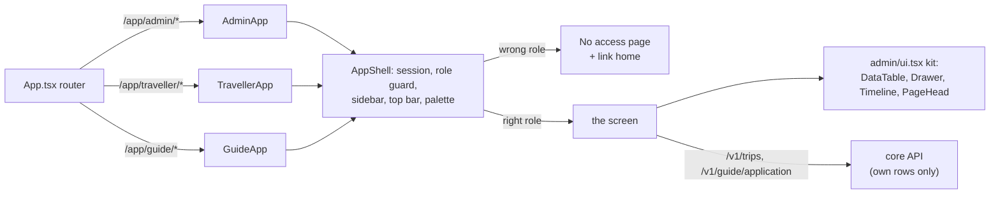

# M4c: Traveller and guide apps, and the last admin polish

Branch `feat/m4c-traveller-guide-ui`. One small API change (filters on
`GET /v1/trips`), no migration. No new architecture decision (ADR): the
shared app shell is a code structure choice inside the web app, and it
follows [ADR 0009](../adr/0009-one-tokens-file.md). The rules are in
[docs/design-system.md](../design-system.md).

## What we built and why

Until M4c a signed-in traveller or guide saw a placeholder dashboard. Now each
gets a real app built from the same design system as the admin console:
travellers manage their own trips and apply to become guides; guides see
their approved profile and what is coming in M9. The first commit also
finishes the admin polish list from the M4b.2 review.

## How it works

1. **One shell, three areas.** `AppShell` is the admin console's shell lifted
   out of `AdminApp`. Each area passes its navigation, who may use it
   (`allow`), whether it is read-only, and the screen. Anyone signed in with
   another role sees "No access" and a link to their own home.
2. **Lazy chunks.** The shell and the shared kit load only when an app opens;
   the trip form, trip page and "Become a guide" are chunks of their own.
3. **Own data only.** The server answers `/v1/trips` and
   `/v1/guide/application` with the signed-in user's rows; any other trip id
   is a 404. M4c added `status` and `q` filters to the trip list, still only
   over the user's own trips.
4. **Forms.** `checkTrip` and `checkApplication` (`member/parts.tsx`) apply
   the API's limits in the browser. Errors show under each field after the
   first submit, focus moves to the first wrong field, the button says
   "Saving…" while it waits, and a toast confirms. An API field error (for
   example `invalid_destination`) is put under its field too.
5. **Demo.** The demo traveller sees the three sample trips with a Sample
   chip. Every write control stays visible but is disabled with "Demo is
   read-only". An admin may open the traveller app to see what travellers
   see: read-only, with no data of their own.

## Key files to open

- `apps/web/src/admin/AppShell.tsx`: the shared shell and the role guard
- `apps/web/src/member/TravellerApp.tsx`, `GuideApp.tsx`: routes and navigation
- `apps/web/src/member/Trips.tsx`, `TripPages.tsx`: list, detail, form
- `apps/web/src/member/BecomeGuide.tsx`: form, status timeline, resubmit
- `apps/web/src/member/parts.tsx`: validation, `Field`, `ConfirmDialog`
- `apps/web/src/api/member.ts`: the member API client
- `services/core/src/main/java/com/plinthwell/roaamm/trips/TripRepository.java`:
  `listForUser` with the new filters
- `scripts/member-stub.mjs`, `scripts/ui-harness.mjs`: the browser checks'
  stand-in API and the 31 new screen states
- `scripts/scan-bottom-centre.mjs`: the search for the "bottom-centre pill"

## New terms

- **App shell:** the frame around every page of a signed-in area (sidebar,
  top bar, menu); only the middle changes between pages.
- **Role guard:** a check that only lets one role into an area and shows a
  clear page to everyone else.
- **Confirm dialog (`alertdialog`):** a small modal that asks before a
  change that is hard to undo, like cancelling a trip.
- **Viewing as:** an admin opening the traveller app read-only, to see what a
  traveller sees.

All four are also in the [glossary](glossary.md).

## Mistakes and fixes

All found while building M4c, before or in this PR's commits.

- **The pill nobody could find.** The M4b.2 review saw a small rounded pill
  at the bottom centre of every admin screen. `scripts/scan-bottom-centre.mjs`
  looked for anything fixed there at 1440x900, 1512x982 and 1920x1080, light
  and dark, pixel ratio 1 and 2, with reduced motion, scrolled, and after a
  drawer closed, in headless and in a visible Chrome window, and once more on
  the live demo admin. It found nothing: the only fixed or sticky things are
  the sidebar, the top bar and the table headers. The page does not draw the
  pill; its source is **not verified**. The grabber (the phone sheet's drag
  handle) is now in the DOM only below 768 px, and the UI check fails if
  anything fixed sits at the bottom centre (commit `d2df590`).
- **A stale "Not verified" after verifying.** The new ID card reloaded
  through the 30 s read cache, which the write did not clear, so it showed
  the old status. A unit test caught it; the card now clears the cache.
- **A click that did not count as a click.** The screenshot harness clicked
  "Create trip" with `element.click()` inside the page. The browser does not
  treat that as user input, so the error messages that appeared were counted
  as layout shift (0.05). A real pointer click (Puppeteer's `click`) fixed the
  measurement; nothing in the app changed.
- **A tap area that leaked sideways.** The × on a chosen language had a
  44 px hit area that stuck out of its chip, so the UI check saw clipped
  text on phones. Now the whole chip is the remove button.
- **Green on a Mac, red in CI, again.** The first CI run of this PR failed
  the UI check on the guide overview at 390 px: 0.0214 layout shift
  ([run 46146145971](https://github.com/Vishwath-Narayana/roaamm-travel-app/actions/runs/46146145971)).
  On the slower runner the "Coming in M9" cards painted before the
  application card had grown from its skeleton, so they were pushed down.
  Locally the data arrived first and it never showed. Fix (`4f772e0`): the
  cards render together once the profile has answered, the same rule as the
  other overviews.
- **A late lead line.** The edit page's lead showed the trip title once it
  arrived, which pushed the form down (0.012 CLS at 768 px). The lead is now
  fixed text.

## Try it yourself

1. Open the live demo, choose "Open as Traveller", and try "New trip": the
   button explains why it is disabled.
2. After `pnpm build`, run
   `node scripts/check-ui-tokens.mjs --only become-guide-rejected,become-guide-resubmit --verbose`.
3. Run `node scripts/scan-bottom-centre.mjs` and read the list of what sits
   at the bottom of the viewport.

## Test yourself

1. Why does a wrong role see a page instead of being redirected?
2. Why does the server answer 404, not 403, for another user's trip?
3. The browser already checks the form. Why does the server check again?
4. How does a rejected applicant "edit and resubmit" when the API has no
   update endpoint for applications?
5. Why do sheets without a footer hug their content, but sheets with one do not?

## Answers

1. A redirect hides what happened. "No access" says plainly that this area
   is for another role and offers the way home.
2. A 403 would confirm that the id exists; a 404 reveals nothing, so trip
   ids cannot be probed.
3. Anyone can call the API without the page. The browser check is for a
   fast, friendly message; the server check is the rule.
4. A rejected application is closed, so the user may open a new one. The form
   starts with the old values and sends a new application; the database
   still allows only one open application per real user.
5. With a footer, a full-height sheet keeps the action bar in one place. With
   no footer, a full-height sheet only adds blank space.
