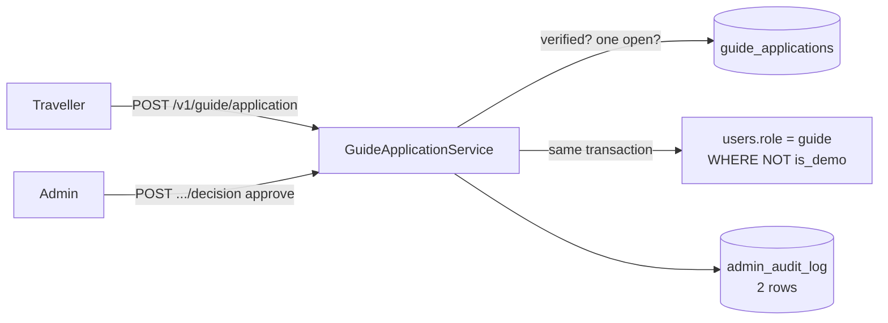

# M4a: Trips, guide applications and the admin console API

Pull request [#26](https://github.com/Vishwath-Narayana/roaamm-travel-app/pull/26),
merged on 2026-11-23. Backend and database only, no UI. Decision:
[ADR 0008](../adr/0008-guide-applications.md). This note was written in M4c
(it was missing); every fact comes from the PR, its commits and the code.

## What we built and why

M4 needed data before screens: a traveller's own trips, a reviewed way to
become a guide, and the reads and decisions an admin console needs. M4a adds
migration V6 (`trips`, `guide_applications`, indexes and demo sample rows)
and the endpoints for members (`/v1/trips`, `/v1/guide/application`) and
admins (`/v1/admin/overview`, `/users`, `/trips`, guide application review
and decisions, and bulk decisions).

## How it works

1. **Trips** belong to one user. Every member query filters by `user_id`, so
   another user's trip id is a 404 for every verb. Up to 20 per real user.
2. **Applying.** Only a verified traveller may apply. A partial unique index
   allows one open application (submitted or in review) per real user.
3. **Deciding.** Review moves submitted to in review; approve or reject ends
   it (a rejection needs a note). Repeating the same decision changes nothing;
   the opposite one is a 409.
4. **The role change.** Approving a real application sets the role to guide
   in the same transaction and writes a `user.role_to_guide` audit row. The
   SQL has `WHERE NOT is_demo AND role = 'traveller'`, so a demo or sample
   user's role can never change.
5. **Bulk.** 1 to 25 ids, one shared note; each row has its own transaction
   and audit row, and the answer lists every row's result.

## Key files to open

- `services/core/src/main/resources/db/migration/V6__trips_and_guide_applications.sql`
- `services/core/src/main/java/com/plinthwell/roaamm/trips/TripService.java`
- `services/core/src/main/java/com/plinthwell/roaamm/guide/GuideApplicationService.java`
- `services/core/src/main/java/com/plinthwell/roaamm/admin/AdminController.java`
- `services/core/src/main/java/com/plinthwell/roaamm/common/PlainText.java`:
  the text rules (length in code points, no `<` or `>`, place names)
- `scripts/ci/m4-smoke.mjs`: the native image smoke test for these endpoints

## New terms

- **IDOR (insecure direct object reference):** reading someone else's data
  by changing an id. Owner-only queries and 404s prevent it.
- **Partial unique index:** unique only for rows that match a condition.
- **Bulk decision:** one request that decides up to 25 rows, each on its own.
- **Sample row:** a fixed simulated demo row (`is_sample`), never changed or
  cleaned up.

All four are in the [glossary](glossary.md).

## Mistakes and fixes

From the PR description of #26:

- **A test that assumed an empty world.** An M2b test asserted that no real
  admin existed anywhere in the shared test database. M4a test classes
  promote admins with the runbook helper, so it failed. It now checks only
  that signup adds no admin.
- **"Verified is final" now covers the demo users too**, so a visitor cannot
  flip the shared demo traveller back to Pending. Three M3 tests and the M3
  smoke test had verified as the demo traveller; they now use the demo guide.

## Try it yourself

1. Read V6 and find the partial unique index on `guide_applications`. Which
   rows does it ignore, and why?
2. In `TripRepository.java`, check that every member query has
   `user_id = :user`.
3. With Docker running, `cd services/core && ./gradlew test --tests '*TripTest'`.

## Test yourself

1. Why is another user's trip a 404 and not a 403?
2. What stops a demo approval from turning the shared demo traveller into a
   guide?
3. Why does each row of a bulk decision get its own transaction?

## Answers

1. A 403 would confirm the id exists; a 404 says nothing, so ids cannot be
   probed.
2. The role update only matches `NOT is_demo AND role = 'traveller'`, and the
   demo admin cannot write at all.
3. So one failing row (already decided, not found) never undoes the rows that
   succeeded, and each decision has its own audit row.
