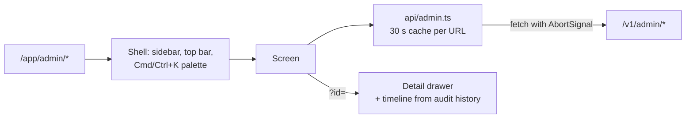

# M4b: The admin console UI

Pull request [#27](https://github.com/Vishwath-Narayana/roaamm-travel-app/pull/27),
merged on 2026-11-23. Built on the M4a API, plus one small additive API change
(`q` search on `GET /v1/admin/trips`). No new ADR. This note was written in
M4c (it was missing); every fact comes from the PR, its commits and the code.
Two polish passes followed: [M4b.1](43-m4b-1-admin-polish.md) and
[M4b.2](44-m4b-2-admin-polish.md).

## What we built and why

Admins had only an inline panel on the M3 dashboard. M4b gives them their own
console at `/app/admin`: a sidebar and top bar instead of the marketing
header, an Overview with key numbers, the Verification queue with bulk
decisions, a board of guide applications, Users, Trips (read-only, no notes)
and the Audit log. The demo admin can read everything and change nothing.

## How it works

1. **Routes.** `/app/admin`, `/verification`, `/guide-applications`,
   `/users`, `/trips` and `/audit`. A detail drawer opens from `?id=`, so it
   can be linked.
2. **Data.** Every read goes through a 30 second cache keyed by URL, so moving
   between screens does not refetch; any write clears it. A request in flight
   is aborted when the user navigates away.
3. **Decisions.** Drawers show a timeline built from the dates and the audit
   history; the bulk bar decides up to 25 selected rows and lists each row's
   result. There is no bulk delete.
4. **Demo.** A banner says the console is read-only; every action control is
   disabled with the reason "Demo is read-only".

## Key files to open

- `apps/web/src/admin/AdminApp.tsx` (since M4c: `AppShell.tsx` holds the shell)
- `apps/web/src/admin/ui.tsx`: the shared building blocks
- `apps/web/src/admin/screens/*.tsx`: one file per screen
- `apps/web/src/admin/BulkBar.tsx`, `MoveMenu.tsx`, `Palette.tsx`
- `apps/web/src/api/admin.ts`: the API client and its cache
- `scripts/admin-stub.mjs`: the simulated API the browser checks use

## New terms

- **Command palette:** a search box (Cmd/Ctrl+K) that jumps to a page or a
  user.
- **Detail drawer:** a side panel (a bottom sheet on phones) with one row's
  details and actions.
- **Kanban board:** columns of cards, one per status.

All three are in the [glossary](glossary.md).

## Mistakes and fixes

Found after #27 was merged and fixed in the polish passes:

- **Colours outside the tokens.** #27 added its pastel pill colours as
  admin-only values in `admin.css`, because the tokens had none. M4b.1 moved
  every colour and size into one tokens file with CI checks
  ([ADR 0009](../adr/0009-one-tokens-file.md)).
- **Percentages on small numbers.** The Overview showed a percent change
  pill. On counts like 2 and 3 that says little; M4b.1 switched to absolute
  numbers ("+3 in 30 days").
- **"Sample" on every row.** Sample rows carried a Sample chip in the console
  although the banner already says everything is simulated. M4b.2 removed it.

## Try it yourself

1. Open the live demo as Admin, press Cmd/Ctrl+K, and type "aud".
2. Open the approved application on the Guide applications board and read
   its timeline: Submitted, In review, Approved, each with its date.
3. After `pnpm build`, run `node scripts/shoot-admin.mjs /tmp/shots --only overview`.

## Test yourself

1. Why does a detail drawer open from `?id=` instead of local state?
2. What does the 30 second cache save, and what clears it?
3. Why are the demo admin's buttons disabled instead of hidden?

## Answers

1. So a drawer can be linked, reloaded and opened from another screen (the
   Overview lists and the palette do this).
2. Repeat requests when moving between screens and tabs. Any write clears it,
   so the next read is fresh.
3. Visitors see the whole console and learn what each action does; the
   tooltip explains why it is unavailable.
