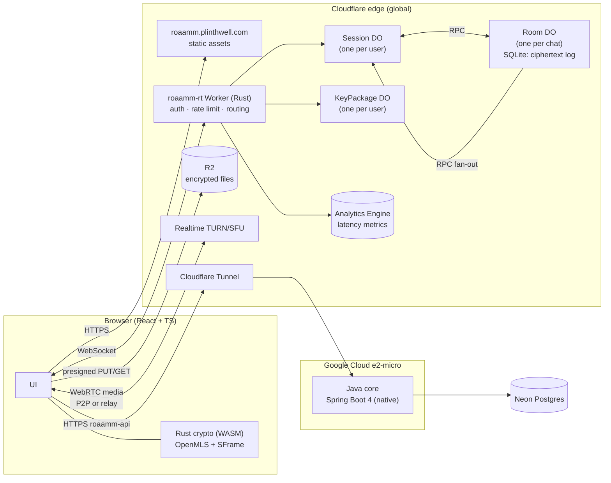
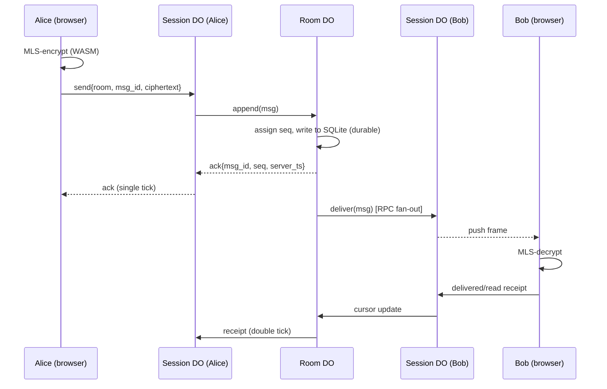

# ROAAMM: System Design

> Doc 2 of 8. Goal: **50,000 concurrent users** and **50,000 concurrent chats** with low latency worldwide, end-to-end encrypted, running on free tiers for the live demo, with a published 50k load test.

## 1. Big picture: a fast path and a steady path

The design splits the system by what each part needs most:

| Path | What travels on it | Needs | Runs on |
|---|---|---|---|
| **Fast path (real-time)** | Chat messages, receipts, typing indicators, online status, call setup, live location updates | Very low latency, global reach, many open connections | **Cloudflare Workers + Durable Objects, written in Rust (WebAssembly)** on hundreds of edge locations |
| **Steady path (business)** | Accounts, passkeys, ID verification, trips, discovery, guides, bookings, payments, admin, reports | Correctness, transactions, relational data | **Java 25 / Spring Boot 4**, GraalVM native image, on a Google Cloud e2-micro server, reached through Cloudflare Tunnel, with **Neon Postgres** |

The fast path **never waits on the steady path**. The edge checks login tokens on its own (Ed25519 signature, public key cached at the edge), so chat keeps working even if the Java server is down.

## 2. Domains

| Subdomain | What runs there |
|---|---|
| `roaamm.plinthwell.com` | Web app (static, served by Cloudflare) |
| `roaamm-rt.plinthwell.com` | Rust edge Worker: WebSocket endpoint, key packages, TURN credentials |
| `roaamm-api.plinthwell.com` | Java core, through Cloudflare Tunnel (the server has no open inbound ports) |
| `roaamm-status.plinthwell.com` | System page: architecture, live metrics, load-test report |

All of them are first-level subdomains, so Cloudflare's free Universal SSL certificate covers them. `plinthwell.com` is already on Cloudflare DNS.

## 3. Real-time design (the fast path)

### 3.1 Connection model: one gateway per user
- Each browser tab opens **one WebSocket** to `roaamm-rt`. The Worker verifies the access token (an Ed25519 JWT, valid for 15 minutes) and rate-limits, then forwards the connection to that user's **Session DO** (`idFromName(userId)`).
- The Session DO holds the open connections for all of that user's devices using the **Hibernation API**: an idle connection costs no compute, and the Durable Object wakes when a message arrives.
- **Why one Session DO per user instead of one socket per chat room:** a single socket per tab no matter how many chats are open. Online status lives in one place. Delivery to offline devices is easy to track. Trade-off: one extra RPC hop (Session DO → Room DO), a few milliseconds when they're in the same region.

### 3.2 Rooms
- One **Room DO per conversation** (1:1 or group, `idFromName(roomId)`). A Durable Object runs one request at a time, which gives each room a **strict message order for free**. That's exactly the "Delivery Service" role that MLS needs (it orders commits; see doc 3).
- The Room DO stores **ciphertext only** in its SQLite storage. Table `messages(seq, msg_id, sender_device, epoch, kind, ciphertext, server_ts)`. It also tracks members and per-device read cursors.
- **Where rooms live:** a Durable Object is created near where it's first used. 1:1 chats between travellers in the same city therefore usually live near both of them. Location hints based on the trip's region can be added.

### 3.3 Send → deliver flow

**Delivery guarantees**
- Alice's message is **acknowledged only after the durable write**. Delivery is at least once. Every message has a client-made `msg_id` (UUIDv7) and clients drop duplicates, so the user sees each message **exactly once**.
- **Offline and reconnecting:** the client sends its last seen `seq` for each room, and the Room DO replays everything after it. Nothing is lost when a socket drops.
- **Typing and online status** are best-effort (not stored), throttled to at most 1 update per second per user per room.

### 3.4 Latency budget (95th percentile targets)
| Hop | Same region | Across continents |
|---|---|---|
| Client → nearest Cloudflare location | 5–30 ms | 5–30 ms |
| Worker → Session DO (usually close to the user) | 1–10 ms | 1–10 ms |
| Session DO → Room DO | 1–10 ms | up to ~120 ms |
| Room DO → recipient's Session DO | 1–10 ms | up to ~120 ms |
| Session DO → recipient | 5–30 ms | 5–30 ms |
| **Total target** | **under 150 ms** | **under 300 ms** |

**How it's measured:**
- On the server: the Room DO records receive and fan-out times and writes them to Workers Analytics Engine.
- On the client: the sender's client times the gap between "send" and "ack received". The recipient's client reports "server_ts → received" (sampled, demo only).
- The System page shows the 50th and 95th percentile delays.

### 3.5 Capacity at 50,000 concurrent users
Assumptions (stated so an interviewer can challenge them):
- 50,000 users connected at once. 50% actively chatting.
- An active user sends 1 message every 15 seconds.
- Average conversation size 2.5 members.
- "50,000 concurrent chats" means 50,000 Room DOs with recent traffic. Each user is in about 2 active conversations.
- Peak = 3 × average.

| Quantity | Average | Peak |
|---|---|---|
| Open WebSockets | 50,000 | 50,000+ (multiple tabs) |
| Session DOs | 50,000 | 50,000 |
| Active Room DOs | 50,000 | 50,000 |
| Messages sent / s | 25,000 ÷ 15 ≈ **1,700** | ≈ 5,000 |
| Deliveries / s (× 1.5 recipients) | ≈ 2,500 | ≈ 7,500 |
| All frames incl. receipts and typing (≈ × 3) | ≈ 8,000 | ≈ **25,000** |
| Messages per busy Room DO | ≈ 0.1–2 / s | far below one Durable Object's ~1,000 requests/s guidance |

**Why it scales:** the load is spread across tens of thousands of separate Durable Objects with no shared hot spot. There is no central message broker to saturate. At this scale, **the limit is cost, not capacity.**

**Group chats** are capped at 256 members. Fan-out to members is batched by Session DO. A 256-member room sending 5 messages a second means about 1,280 deliveries a second, within budget for one Room DO with batching. Bigger "broadcast" channels are out of scope.

**Storage:** about 0.5 KB per message (ciphertext plus metadata). At 1,700 messages a second for 8 busy hours, that's about 49 million messages, roughly 25 GB a day at full scale.
- In production, recent messages stay in the Room DO's SQLite and older ones are archived to R2 (still encrypted).
- On the free demo, real traffic is tiny. Retention is 7 days, purged by Durable Object alarms.

### 3.6 Load-test plan (the proof)
Full detail in doc 6.
- 50,000 k6 virtual users, each holding one WebSocket.
- Paired into 1:1 rooms. Each pair runs on the same load-generator machine, so latency is measured with one clock.
- Ramp up to 50k over 10 minutes, hold for 15 minutes.
- Each user sends a message every 15 seconds.
- Publish: connection success rate, p50/p95/p99 delivery latency, error rate, and the Cloudflare analytics screenshots.
- Run it during a one-month Workers Paid upgrade ($5), with a **spending limit set**.

## 4. Calls
- **Call setup** (offer, answer, network candidates) travels as **MLS-encrypted** messages through the Session and Room DOs, so the server can't see the call setup contents either.
- **Media:** WebRTC peer-to-peer using Cloudflare's free STUN (`stun.cloudflare.com`). If a direct connection fails, the call goes through **Cloudflare Realtime TURN**. Short-lived TURN credentials are issued by the Worker.
- **End-to-end encryption of media:** WebRTC already encrypts each hop (DTLS-SRTP). On top of that we add **SFrame** using the browser's Encoded Transform API, with keys taken from the room's MLS group. So even the relay or SFU only sees ciphertext. Details in doc 3.
- **Capacity math:** if 5% of online users are on calls, that's 2,500 users, or 1,250 calls.
  - About 20% of calls need a relay: about 250 calls.
  - A 1:1 video call relays about 2 × 1.5 Mbit/s ≈ 1.35 GB per hour.
  - So relayed traffic is about 340 GB per hour at full scale.
  - The free 1,000 GB a month covers the demo easily. At real scale it would cost $0.05 per GB.
  - The load test covers call **setup**, not media.
- Group calls (stretch goal): Cloudflare Realtime SFU with SFrame.

## 5. Steady path (Java core)

### 5.1 Responsibilities
- Accounts, passkeys (WebAuthn), email one-time codes.
- Issuing access tokens (Ed25519, 15 minutes) and refresh tokens (rotating, httpOnly cookie).
- **MLS Authentication Service:** signs each device's credential (binds a device's public key to a verified user).
- Profiles, mock ID verification workflow, trips, discovery, connection requests, guides, bookings, Razorpay **test** payments with webhook signature checks, reports and moderation, SOS and check-in records, emergency contacts, admin.

### 5.2 Data model (Postgres)
`users`, `devices` (device credential public keys), `passkeys`, `email_otps`, `verifications` (status, encrypted R2 object key), `trips`, `trip_matches` (materialised overlap), `connections`, `rooms` (metadata only: id, type, members, created_at; never content), `guides`, `guide_slots`, `bookings`, `payments`, `reports`, `emergency_contacts`, `checkins`, `sos_events`, `audit_log`.
- Migrations with Flyway.
- Every table has `created_at` and `updated_at`.
- Soft delete where users can delete content.

### 5.3 Load on the core at 50k users
- About 30 core requests per user per hour → about 420 requests/s on average, about 1,200 at peak.
- **Ways to keep this load small:**
  - Read-heavy public data is cached at the edge: trip discovery by city and date (cached 30 s), guide listings, public profiles.
  - Login tokens are checked at the edge, so there's no session lookup on the core.
  - Writes and uncached reads that reach the core: about 150–300 requests/s.
- **Demo deployment:** one e2-micro server. We **measure its real limit** with k6 and publish it.
- **Scale-out plan, documented:**
  - The core is stateless, so run N copies (Cloudflare Tunnel accepts several connector replicas, or use a load balancer).
  - Neon autoscaling with a read replica.
  - Connection pooling (Neon's built-in pooler).
  - The math shows about 4–6 small instances covering peak.

### 5.4 Edge ↔ core
- Browser → `roaamm-api` → Cloudflare → **Tunnel** → core. TLS all the way; the server exposes no ports.
- Edge → core (for example, checking that a user may create a room with someone): HTTPS to `roaamm-api` with a **service token**, plus short-lived caching of the answer.
- Core → edge (for example, "user X is blocked, close their rooms"): calls a Worker admin endpoint authenticated with a signed request.

## 6. Failure modes and how the system copes
| Failure | Effect | What we do |
|---|---|---|
| Durable Object restarts or moves | Sockets drop | Client reconnects with exponential backoff plus random jitter, then resumes from the last seen `seq`. Nothing is lost (messages were stored before the ack). |
| Java core or server down | No logins, bookings or trip edits | Chat, calls and SOS on the edge keep working until tokens expire. UI shows a "some features unavailable" banner. Health check alert. |
| Neon wakes from idle | First query ~0.5 s slower | Warm-up ping before demo hours. The UI shows loading skeletons. |
| Free-tier daily limit reached | Further operations of that type fail until midnight UTC | Alert at 70% of quota, clear error banner in the UI, the demo is light on traffic by design, the load test runs only during the paid month. |
| Everyone reconnecting at once after an outage | Spike of new connections | Random jitter on backoff, a connection rate limit in the Worker, Session DOs start cheaply. |
| Abuse or spam | Load and cost | Per-user and per-IP rate limits in the Worker, Cloudflare Turnstile on sign-up, 64 KB frame limit, attachments uploaded only through presigned R2 URLs (max 10 MB), report and block. |
| Lost or new device | Can't decrypt old messages | Add the new device to the MLS group (from an existing device, or from the passphrase-protected key backup). See doc 3. |
| A region slows down | Higher latency for people there | Durable Objects stay put; clients reach the nearest healthy Cloudflare location. Analytics Engine latency by region shows it on the System page. |

## 7. Real-time protocol (WebSocket frames)
Encoded as JSON at first, CBOR later as an optimisation. Every frame carries `{v, type, id}`.
- **Client → server:** `hello{token, device_id, cursors}`, `send{room, msg_id, epoch, ciphertext}`, `receipt{room, seq, kind}`, `typing{room}`, `presence{state}`, `call{room, ciphertext}` (call setup is end-to-end encrypted), `location{room, ciphertext}`, `ping`.
- **Server → client:** `welcome`, `ack{msg_id, seq, ts}`, `deliver{room, seq, sender_device, ciphertext, ts}`, `receipt{...}`, `typing{...}`, `presence{...}`, `error{code}`, `pong`.
- MLS handshake messages (proposals, commits, welcome) use `send` with `kind` set to the handshake type. The Room DO only **orders** them and can't read them.

## 8. Observability
- **Logs:** structured JSON. Workers logs plus Java logs (via OpenTelemetry) go to **Grafana Cloud**.
- **Traces:** OpenTelemetry trace IDs passed from browser → Worker → core.
- **Metrics:** Analytics Engine (edge latency, frames per second, open connections) and Micrometer (Java).
- **Errors:** Sentry (browser, Worker, Java).
- **System page:** reads aggregated metrics from Analytics Engine through a small cached endpoint and shows p50/p95 latency, open connections and messages per minute over the last 24 hours.
